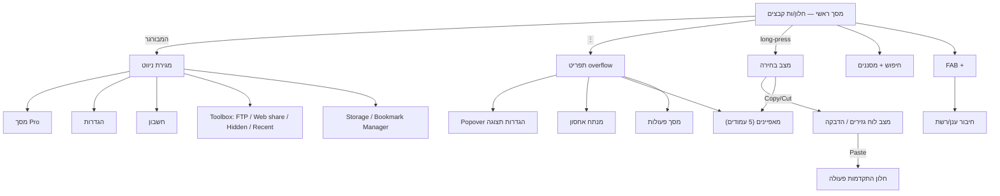

# 04 — ארכיטקטורת מידע

## מפת ניווט

## מלאי מסכים

| מסך / רכיב | סוג | נצפה בצילום |
|---|---|---|
| רשימת קבצים (חלון) | מסך ראשי | ✅ 1, 2 |
| מגירת ניווט | Modal drawer | ✅ 3 |
| תפריט overflow | Dropdown menu | ✅ 2 |
| הגדרות תצוגה | Popover עשיר | ✅ 1 |
| Pro | מסך מלא עם חץ חזרה | ✅ 4 |
| מצב בחירה, לוח גזירים, התקדמות | מצבי סרגל/FAB | ❌ (מתיעוד NeatBytes) |
| מאפיינים, חיפוש, מנתח, פעולות, הגדרות, חיבור, נגנים, עורך | מסכים | ❌ |

## מגירת ניווט — מבנה (צילום 3)

1. **כותרת**: לוגוטיפ “Solid Explorer” בכחול, רקע תכלת בהיר עם עיגולים דקורטיביים; אייקונים: חשבון, הגדרות, ⋮.
2. **Upsell**: “BECOME A [Pro]” ← כרטיס “Unlock all the Pro features / בלי פרסומות” + פס “Special offer”.
3. **מקומות אחסון** (מתקפל): זיכרון פנימי (89.4 GB / 222 GB), NAS (647 GB / 1.74 TB). כל פריט: אריח אייקון, שם, פנוי/סך הכל, טבעת ניצול.
4. **פועל ברקע**: “הקבצים שלי — /storage/emulated/0”.
5. **מועדפים**: Download (זיכרון פנימי).
6. **אוספים**: קבצים אחרונים, תמונות, מוזיקה… (נחתך בצילום).
7. **כלים / Toolbox** — מתועד ב-N, מתחת לאזור הגלוי [סדר לא אומת].

כל כותרת סעיף מלווה חץ קיפול (צורת מגן/לב כהה) — הסעיפים ניתנים לכיווץ.

## תפריט overflow — סדר מדויק (צילום 2)

| # | פריט | אייקון | הערה |
|---|---|---|---|
| 1 | Analyze | תיקייה עם זכוכית מגדלת | לא מתורגם |
| 2 | בחר הכל | ריבוע מקווקו עם מילוי | |
| 3 | מאפיינים | ⓘ | של התיקייה הנוכחית |
| 4 | הגדרות תצוגה | רשימה | פותח את ה-popover |
| 5 | מסנן | שלוש שורות מתקצרות | |
| 6 | אפשרויות תיקייה ▸ | tune / sliders | תת-תפריט |
| 7 | פעולות | גרף מגמה עולה | רשימת פעולות רקע |

## סרגל במצב בחירה (N)

Copy · Cut · Delete · Archive · Hide · Share · Select all · Select inverse · Add to bookmarks (תיקיות) · Open with · Create shortcut · Rename · Properties

## מאפיינים — עמודים (N)

1. פרטים (+ מדיה/APK)
2. תוכן — גודל ואחוז מהנפח
3. סוגי קבצים — ספירה לפי סוג
4. 20 הקבצים הגדולים — עם בחירה ופעולה
5. Checksums (MD5/SHA) · תכונות הרשאה/בעלים (root בלבד)

## הגדרות לפי הקשר

| רמה | מה נשמר |
|---|---|
| גלובלי | ערכה, סט אייקונים, dual-pane, pinch on/off |
| לתיקייה | מצב תצוגה, מיון, מדורים (“רק בתיקייה זו”) |
| לחלון | מיקום נוכחי, היסטוריה, סשן רקע |
| לאחסון | פרטי חיבור, סדר במגירה |

