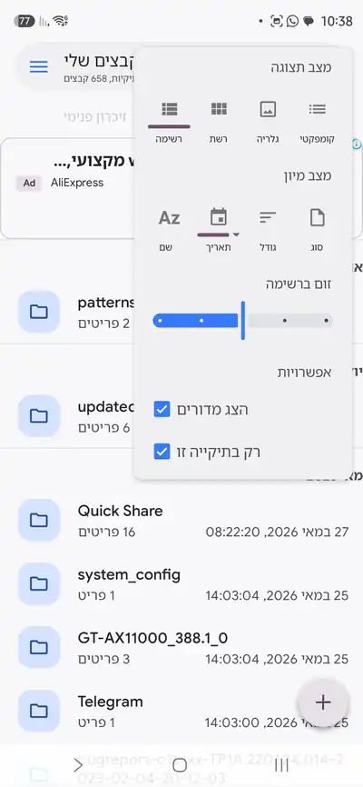
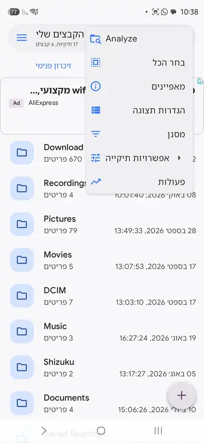
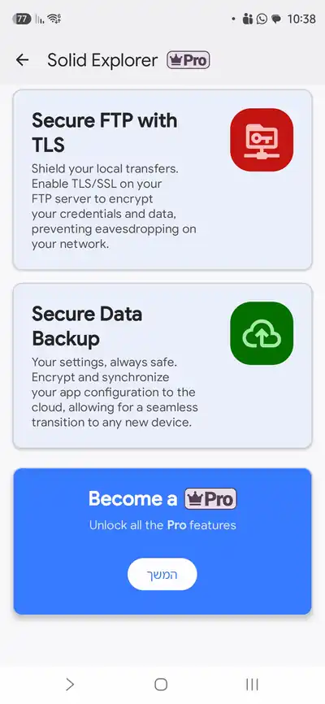

# צילומי מסך — Solid Explorer 3.6.x

צולמו ב-13/10/2026 במכשיר Samsung, ממשק בעברית. מקור: 1080×2340 JPEG; כאן מוקטנים ל-400px WebP.
הצבעים והמידות ב-[05](../research/05-design-language.md) נמדדו על המקור ברזולוציה מלאה.

| # | מסך | מה רואים |
|---|---|---|
| 1 |  | Popover “הגדרות תצוגה”: מצב תצוגה, מצב מיון, זום ברשימה, אפשרויות. מאחור — רשימת תיקיות, כרטיס פרסומת, FAB |
| 2 |  | תפריט overflow (7 פריטים), רשימת תיקיות שורש האחסון |
| 3 |  | מגירת ניווט: upsell, מקומות אחסון (פנימי + NAS), פועל ברקע, מועדפים, אוספים |
| 4 |  | מסך Pro: כרטיסי Secure FTP with TLS, Secure Data Backup, כרטיס CTA “המשך” |

